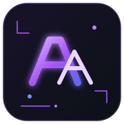

<!-- ANUGRAH TRIPATHI | AI & FULL-STACK DEVELOPER PROFILE -->

<div align="center">

  

  <br/>

  <h1>ANUGRAH TRIPATHI</h1>
  <h3><code>AI ENGINEERING · FULL-STACK DEVELOPMENT · PRODUCT BUILDING</code></h3>

  

  <br/>

  <a href="https://www.linkedin.com/in/anugrah-tripathi-96929032b/"></a>
  <a href="https://portfolio-website-eta-liart-74.vercel.app/"></a>
  <a href="mailto:anugrahtripathi2006@gmail.com"></a>

  <br/><br/>

  

</div>

---

### ⚡ 01 // WHOAMI `~/whoami`

```console
$ cat about.txt
NAME      : ANUGRAH TRIPATHI
ROLE      : AI & FULL-STACK DEVELOPER
FOCUS     : AI APPLICATIONS, BACKEND SYSTEMS, PRODUCT ENGINEERING
CURRENT   : BCA STUDENT · LEO TLSS
MINDSET   : BUILD → TEST → LEARN → IMPROVE
```

I build software at the intersection of AI and full-stack development. My projects include LLM-powered applications, machine-learning workflows, assistant experiences, and web products. I care about making projects understandable, reproducible, and useful beyond a demo.

- 🔭 Building AI-powered tools and web applications
- 🧠 Exploring LLM integration, model evaluation, and retrieval-based systems
- 🧰 Working with Python, TypeScript, Next.js, FastAPI, Flask, and AI APIs
- 🎓 BCA student, graduating in 2027
- 🚀 Founder of LEO TLSS

### 🛠️ 02 // TECH_STACK `~/stack`

<div align="center">
  <picture>
    <source media="(prefers-color-scheme: dark)" srcset="https://skillicons.dev/icons?i=python,java,js,ts,react,nextjs,nodejs,fastapi,flask,postgres,supabase,docker,git,github,vercel&perline=8&theme=dark">
    <source media="(prefers-color-scheme: light)" srcset="https://skillicons.dev/icons?i=python,java,js,ts,react,nextjs,nodejs,fastapi,flask,postgres,supabase,docker,git,github,vercel&perline=8&theme=light">
    
  </picture>
</div>

<p align="center">
  
  
  
  
</p>

### 🚀 03 // SELECTED_PROJECTS `~/projects`

<table>
  <tr>
    <td width="50%" valign="top">
      <h3>◈ End-to-End ML Pipeline API</h3>
      <p>ML workflow for dataset validation, training, model evaluation, prediction APIs, and basic monitoring.</p>
      <p><strong>Stack:</strong> Python · FastAPI · scikit-learn</p>
      <a href="https://github.com/anugrah2006-ui/End-to-End-Production-ML-Pipeline-API">↗ Explore repository</a>
    </td>
    <td width="50%" valign="top">
      <h3>◈ Sentiment & Emotion Analyzer</h3>
      <p>Text analysis dashboard with transformer-based predictions, batch CSV workflows, history, and analytics.</p>
      <p><strong>Stack:</strong> Python · FastAPI · Transformers · PyTorch · Next.js</p>
      <a href="https://github.com/anugrah2006-ui/Multi-class-Sentiment-Emotion-Analyzer">↗ Explore repository</a>
    </td>
  </tr>
  <tr>
    <td width="50%" valign="top">
      <h3>◈ AI Career Coach</h3>
      <p>Resume upload and role-specific AI feedback, including strengths, gaps, suggestions, and interview preparation.</p>
      <p><strong>Stack:</strong> Python · Flask · Groq API</p>
      <a href="https://github.com/anugrah2006-ui/AI-Career-Coach-Resume-Analyzer">↗ Explore repository</a>
    </td>
    <td width="50%" valign="top">
      <h3>◈ HIRA V2</h3>
      <p>Windows assistant combining voice/text input, AI-provider fallback, productivity commands, and system controls.</p>
      <p><strong>Stack:</strong> Python · Gemini/Groq APIs</p>
      <a href="https://github.com/anugrah2006-ui/HIRA-V2">↗ Explore repository</a>
    </td>
  </tr>
</table>

### 📈 04 // CONTRIBUTION_ACTIVITY `~/activity`

<div align="center">

  

  <br/>

  
  

  <br/><br/>

  <picture>
    <source media="(prefers-color-scheme: dark)" srcset="https://raw.githubusercontent.com/anugrah2006-ui/anugrah2006-ui/output/snake-dark.svg">
    <source media="(prefers-color-scheme: light)" srcset="https://raw.githubusercontent.com/anugrah2006-ui/anugrah2006-ui/output/snake.svg">
    
  </picture>

</div>

### ◈ 05 // NOW_BUILDING `~/now`

```text
FOCUS_01  / AI-powered product workflows
FOCUS_02  / Reliable APIs and backend integration
FOCUS_03  / Model evaluation and practical deployment
FOCUS_04  / Better documentation, tests, and developer experience
```

### 🤝 06 // CONNECT `~/connect`

<div align="center">

  <p>Open to connecting with builders, engineering teams, and people working on useful AI products.</p>

  <a href="https://www.linkedin.com/in/anugrah-tripathi-96929032b/"></a>
  <a href="https://portfolio-website-eta-liart-74.vercel.app/"></a>
  <a href="mailto:anugrahtripathi2006@gmail.com"></a>

  <br/><br/>

  <sub>BUILD WITH INTENT · DOCUMENT THE DETAILS · KEEP IMPROVING</sub>

</div>
